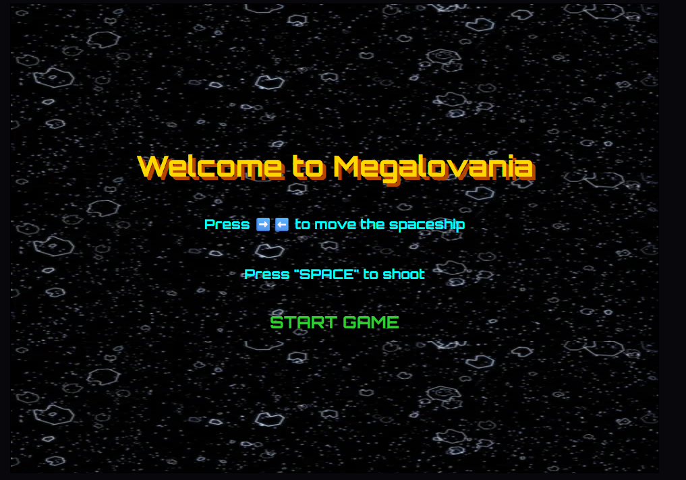

# 🚀 Megalovania

A space shooter inspired by Space Invaders and 80s arcade shooters.

[▶️ Play Megalovania here](https://lewiskull.github.io/Project-Space-Shooter/)

## 🎮 How to play

* Use the ⬅️ left and ➡️ right arrow keys to move your ship.
* Press the space bar to shoot.
* Destroy aliens to increase your score.
* Reach 20 points to face the final boss.
* Defeat the boss to win.
* You have 3 lives. If an alien or a boss bullet hits you, you lose one.
* If you lose all your lives, it's game over.
* Use the 🎵 button to turn the music on or off.

## ✨ Features

* Shooting system with collision detection
* Aliens that fall from random positions
* Final boss that moves side to side and shoots back
* Start, win and game over screens with a replay button
* Shooting sound effects
* Background music that changes when the boss appears

## 🛠️ Built with

* HTML5
* CSS3
* JavaScript (ES6 classes, no libraries)
